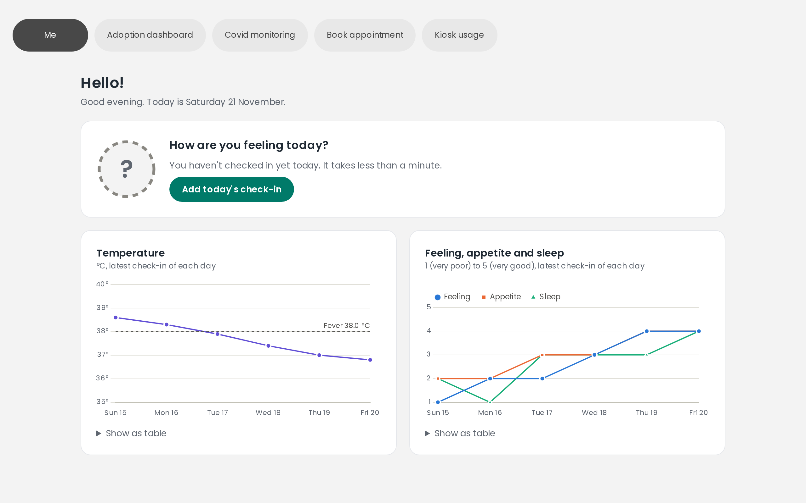
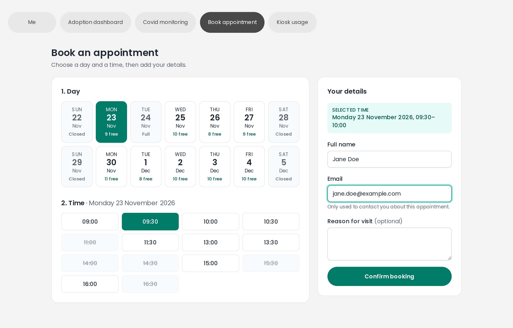
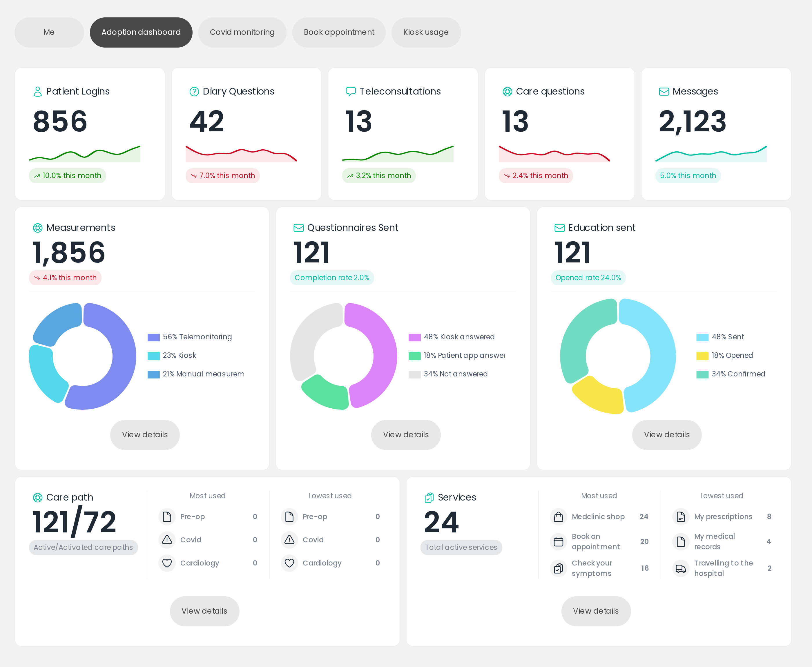
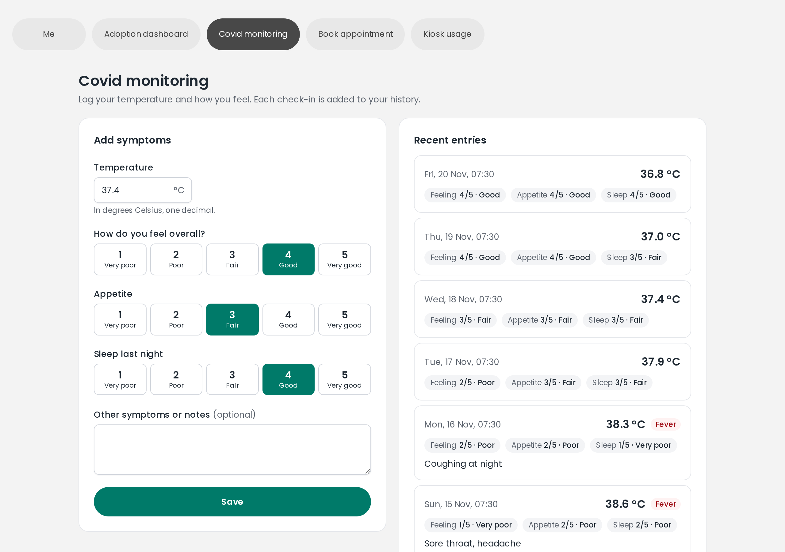
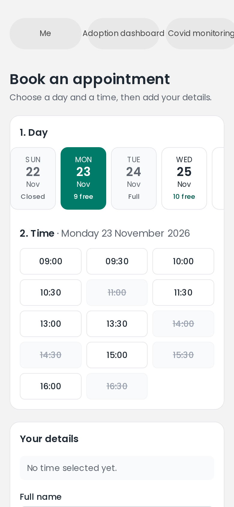

# BeWell Adoption Dashboard

Adoption dashboard for the BeWell web app, with a patient overview, symptom check-ins and appointment booking.

- **Me** (opens first): a greeting, a face that shows how you feel today (smiling for a feeling rating of 4–5, neutral for 3, sad for 1–2, a question mark before today's check-in), and charts of temperature and of feeling, appetite and sleep, one point per day.
- **Adoption dashboard**: usage KPIs (logins, questionnaires, measurements, care paths, services) loaded from the API. **View details** opens a dialog that explains the colors of the card's ring chart (each part with its count and share) and of the trend badges.
- **Book appointment**: patients pick a day and a free time slot, enter their details and get a confirmation. If someone else books the same slot first, the app says so, refreshes the times and keeps what the patient typed.
- **Covid monitoring**: patients log their temperature and rate their wellbeing, appetite and sleep from 1 to 5, with optional notes. Saved check-ins appear in a history list, and temperatures of 38.0 °C or higher are marked as fever.



<details>
<summary>More screenshots</summary>









</details>

**Demo:** https://lidiiamorozova.github.io/adoption-dashboard/ (a static GitHub Pages build that runs without the API: bookings and check-ins are saved only in your browser; see [Demo on GitHub Pages](#demo-on-github-pages)).

## Tech stack and tools

### How the parts fit together

```
Browser (Vue app)  ──/api/*──▶  Vite dev server (port 8080)  ──proxy──▶  NestJS API (port 3000)  ──▶  memory
```

The Vue app never talks to a database. It calls `/api/...`; in development Vite forwards those calls to the NestJS API, which keeps all data in the memory of its own process.

### Web app (`/`)

| Tool | Version | What it is used for |
| --- | --- | --- |
| [Vue](https://vuejs.org) | 3.5 | UI components, written as single-file components with `<script setup lang="ts">` |
| [TypeScript](https://www.typescriptlang.org) | 5.8 | Types for components, stores and API responses (`strict` mode) |
| [Pinia](https://pinia.vuejs.org) | 3 | State stores: `dashboard`, `booking`, `symptoms`; each tracks loading and error state |
| [Tailwind CSS](https://tailwindcss.com) | 4.1 | Styling of the newer screens (Me, Covid monitoring, booking, dialogs); the original dashboard cards keep their scoped CSS |
| [Vite](https://vite.dev) | 6 | Dev server with hot reload, `/api` proxy and the production build |
| [Chart.js](https://www.chartjs.org) | 4 | Ring charts on the dashboard and the line charts on Me |
| [D3](https://d3js.org) | 7 | Scales and paths for the small sparklines on the dashboard cards |
| [Heroicons](https://heroicons.com) | 2 | Icons |
| Native `fetch` | – | HTTP calls, wrapped in `src/api/http.ts` with one error type (`ApiError`) |
| Native `<dialog>` | – | The color guide behind **View details** |

There is no router library: the active tab lives in the URL hash (`#me`, `#appointments`, …).

### API (`/server`)

| Tool | Version | What it is used for |
| --- | --- | --- |
| [NestJS](https://nestjs.com) | 11 (on Express 5) | Controllers, services and dependency injection for the REST API |
| [class-validator](https://github.com/typestack/class-validator) + class-transformer | 0.14 / 0.5 | Validating and trimming request bodies and query parameters |
| Nest CLI | 11 | `nest start --watch` in development and `nest build` |
| Node.js | 20.19+ (22 recommended) | Runtime for the API and the build tools |

### Quality and tests

| Tool | What it checks |
| --- | --- |
| [ESLint](https://eslint.org) 9 + eslint-plugin-vue + typescript-eslint | Code style and common mistakes in the web app |
| vue-tsc / tsc | Type errors in the web app and the API |
| [Jest](https://jestjs.io) + ts-jest | Unit tests of the API services |
| [Supertest](https://github.com/ladjs/supertest) | HTTP tests of the API routes, status codes and validation |
| [Playwright](https://playwright.dev) 1.56 | End-to-end tests in Chromium on a desktop and a Pixel 7 viewport, including keyboard use and the double-booking case |
| [GitHub Actions](https://docs.github.com/actions) | `ci.yml` runs lint, type checks, API tests, builds and both Playwright suites on every push to `main` and every pull request; `pages.yml` deploys the demo to GitHub Pages from `main` |

### Where data is stored

| Data | Where | How long it lasts |
| --- | --- | --- |
| Bookings and taken slots | Memory of the NestJS process | Until the API restarts |
| Symptom check-ins | Memory of the NestJS process (starts with six sample days) | Until the API restarts |
| Dashboard figures | A constant in `server/src/dashboard/dashboard.data.ts` | Fixed sample data |
| Selected day, slot, form input | Pinia stores in the browser tab | Until the page is reloaded |
| Active tab | URL hash | As long as the URL |

With the API, nothing is written to a database, to files, to cookies or to `localStorage`. In the GitHub Pages demo there is no API, and bookings and check-ins are kept in the visitor's `localStorage` instead (see below). In watch mode the API restarts whenever a file in `server/src` changes, which also clears the data.

## Getting started

Requirements: Node.js 20.19+ (22 recommended) and npm.

```bash
git clone https://github.com/LidiiaMorozova/adoption-dashboard.git
cd adoption-dashboard
npm install
npm --prefix server install
```

Run the API and the web app in two terminals:

```bash
npm run dev:server   # API on http://localhost:3000/api
npm run dev          # Web app on http://localhost:8080
```

Vite proxies `/api` to the API, so open http://localhost:8080 and go to the **Book appointment** tab, or open http://localhost:8080/#appointments directly.

### Scripts

| Command | What it does |
| --- | --- |
| `npm run dev` | Web app with hot reload |
| `npm run dev:server` | API in watch mode |
| `npm run build` | Type-checks and builds the web app into `dist/` |
| `npm run lint` | ESLint for the web app |
| `npm run test:e2e` | Playwright tests; starts both servers itself when they are not running |
| `npm run build:demo` | Builds the GitHub Pages demo into `dist/` (no API needed, served from `/adoption-dashboard/`) |
| `npm run preview:demo` | Serves that build on http://localhost:4173/adoption-dashboard/ |
| `npm run test:e2e:demo` | Playwright tests of the demo build |
| `npm --prefix server test` | API unit and HTTP tests |
| `npm run screenshots` | Refreshes the README screenshots (needs both servers running) |

The first Playwright run needs a browser: `npx playwright install chromium`.

### Configuration

| Variable | Where | Default | Purpose |
| --- | --- | --- | --- |
| `VITE_API_URL` | web build | `/api` | API base URL when the API is on another origin |
| `API_PROXY_TARGET` | Vite dev/preview | `http://localhost:3000` | Where `/api` is proxied |
| `PORT` | API | `3000` | API port |
| `CORS_ORIGIN` | API | not set | Comma-separated origins allowed to call the API |
| `CLINIC_TIME_ZONE` | API | `Europe/Brussels` | Time zone that decides what "tomorrow" is |

## API

All routes are under `/api`.

| Method | Path | Result |
| --- | --- | --- |
| `GET` | `/health` | `{status: "ok"}` |
| `GET` | `/dashboard` | Dashboard cards |
| `GET` | `/appointments/days` | The next 14 days with total and free slot counts |
| `GET` | `/appointments/slots?date=YYYY-MM-DD` | Slots of one day, each with `available` |
| `POST` | `/appointments/bookings` | Books a slot: `{slotId, patientName, email, reason?}` |
| `GET` | `/appointments/bookings/:id` | One booking |
| `GET` | `/covid/symptom-entries` | Symptom check-ins of the last 14 days, newest first |
| `POST` | `/covid/symptom-entries` | Saves a check-in: `{temperature, wellbeing, appetite, sleep, notes?}`; temperature 34.0–43.0 with one decimal, ratings 1–5 |

Errors use Nest's JSON shape plus a `code`:

- `400`: validation failed; `message` lists the problems.
- `404` `SLOT_NOT_FOUND`: no such slot in the booking window.
- `409` `SLOT_TAKEN`: the slot was booked by someone else.

## Technical decisions

- **One source of truth for data.** The dashboard figures moved from a hard-coded file in the web app to `GET /api/dashboard`. Cards refer to icons by name (`"calendar"`), and the web app maps names to Heroicons, so the API stays free of UI code.
- **Pinia stores own loading state.** Each store keeps `status` (`idle | loading | success | error`) and an error message. Components show skeletons, an error panel with **Try again**, or the data. The booking store ignores responses from older slot requests, so switching days quickly never shows the wrong day's times.
- **Double bookings are prevented on the server.** `AppointmentsService.book` checks and claims a slot in one synchronous step. Node runs it without interruption, so only one of two simultaneous requests can win; the other gets `409 SLOT_TAKEN`. With a database, the same guarantee comes from a unique constraint on the slot, or a conditional update inside a transaction.
- **The conflict is handled as a normal outcome.** On `409` the web app shows an alert that names the taken time, moves focus to it, reloads the times and day counts, clears the selection, and keeps the form.
- **Accessibility and keyboard use.** Tabs (Me, Adoption dashboard, Covid monitoring, Book appointment, Kiosk usage) follow the WAI-ARIA tabs pattern (arrow keys, Home/End) and are kept in the URL hash. Days and times are real buttons with `aria-pressed` and descriptive labels ("Tuesday 24 November 2026, fully booked"). Form errors are linked with `aria-describedby`, the first invalid field gets focus, and the confirmation heading receives focus.
- **Symptom ratings are native radio buttons.** Each 1–5 scale is a `fieldset` of radio inputs styled as buttons, so screen readers announce them as one group and the arrow keys move between options. The temperature field accepts both `37.5` and `37,5`.
- **Responsive layout.** On phones the day strip scrolls sideways and the form moves under the time grid. Playwright runs every test on a desktop and a Pixel 7 viewport.
- **Demo-friendly data.** Slots are 30 minutes, 09:00–17:00 on weekdays with a lunch break. About 30% start out booked, and the second working day is fully booked to show the "no free times" state. The symptom history starts with one sample check-in per day for the previous six days (a recovery from fever), so the Main charts have a trend; today is left for you. Data lives in memory and resets when the API restarts.
- **The color guide is a native `<dialog>`.** It keeps focus inside while open, closes with Escape, a click outside or **Got it**, and returns focus to the **View details** button.
- **Charts follow one rule set.** Temperature and the 1–5 ratings are separate charts rather than one chart with two y-axes. Each point is the latest check-in of a day, lines are straight because nothing was measured between check-ins, and the three rating series use a fixed palette checked for color-vision deficiencies, with different marker shapes and a legend. Every chart has a tooltip and a "Show as table" view.
- **Calendar dates as strings.** Days are `YYYY-MM-DD` strings computed in the clinic's time zone and formatted in UTC in the browser, so the visitor's time zone never shifts a day.
- **One code base for the app and the demo.** The demo build swaps the HTTP calls for `src/api/demo.ts`, which answers the same routes with the same status codes in the browser. It imports the API's framework-free modules (`schedule.ts`, `calendar.ts`, `covid.rules.ts`, `dashboard.data.ts`) rather than copying them, so the calendar, sample data and limits are the same in both. The regular build never loads this code.
- **Vite instead of Vue CLI.** Vue CLI is in maintenance mode; Vite starts faster and supports TypeScript and Tailwind 4 natively.

## Project structure

```
src/
  api/            fetch wrapper (ApiError), typed endpoints, demo.ts (in-browser API for the demo)
  stores/         Pinia stores: dashboard, booking, symptoms
  pages/          MainOverview, AdoptionDashboard, AppointmentBooking, CovidMonitoring
  components/     dashboard cards, main/ (MoodFace), charts/ (LineChart), booking/, covid/, common/
  types/          types shared by the API responses
server/src/
  dashboard/      GET /api/dashboard
  appointments/   days, slots and bookings (service, controller, DTOs)
  covid/          symptom check-ins
e2e/              Playwright tests against the API
e2e-demo/         Playwright tests of the GitHub Pages demo
.github/workflows ci.yml (checks) and pages.yml (demo deployment)
```

## Deployment

### Demo on GitHub Pages

`.github/workflows/pages.yml` builds the demo (`npm run build:demo`) and publishes it on every push to `main`, or when started by hand from the Actions tab.

One-time setup in the repository settings:

1. **Settings → Pages → Build and deployment → Source: GitHub Actions.**
2. On GitHub Free, Pages needs a **public** repository. Paid plans (Pro, Team, Enterprise) can publish from a private one, but the site itself is public either way.

How the demo differs from the full app:

- There is no API. `src/api/demo.ts` answers requests in the browser and stores bookings and check-ins in `localStorage`, so each visitor sees only their own data.
- Opening the booking page in two tabs of the same browser shows the "already booked" case.
- A banner explains this and has a **Reset demo data** button.

### Full app

The web app is a static `dist/` build; the API is a Node process (`npm --prefix server run build && npm --prefix server start`). To host them on different origins, build the web app with `VITE_API_URL=https://<api-host>/api` and start the API with `CORS_ORIGIN=https://<web-host>`.

## Known limitations

- Bookings and symptom check-ins are stored in memory: they are lost on restart and not shared between API instances.
- There is no authentication, so all visitors share one symptom history. There is no booking cancellation or email confirmation.
- Web and API types are kept in sync by hand (`src/types` mirrors `server/src/**/*.types.ts`).
